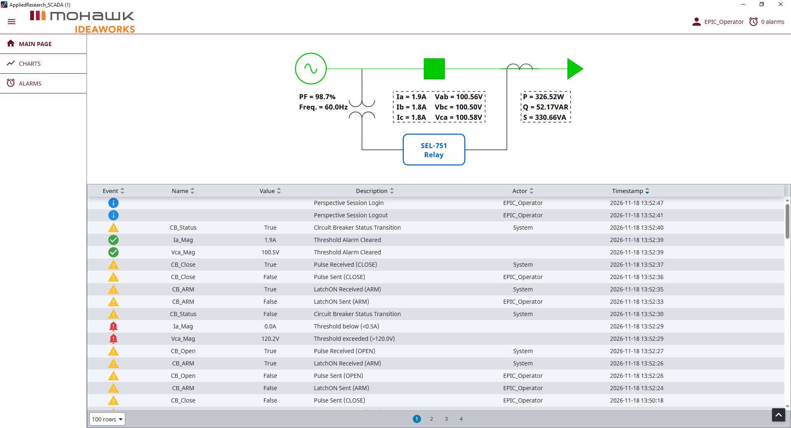
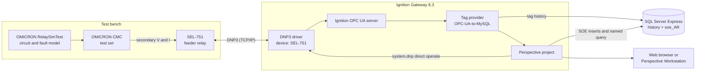
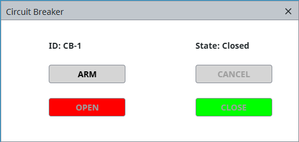
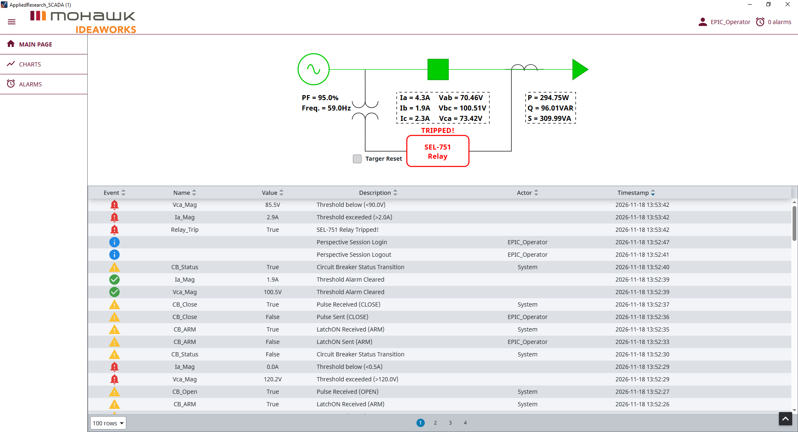
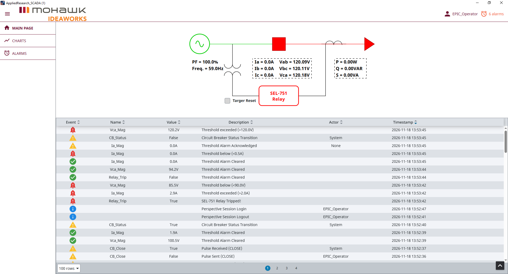
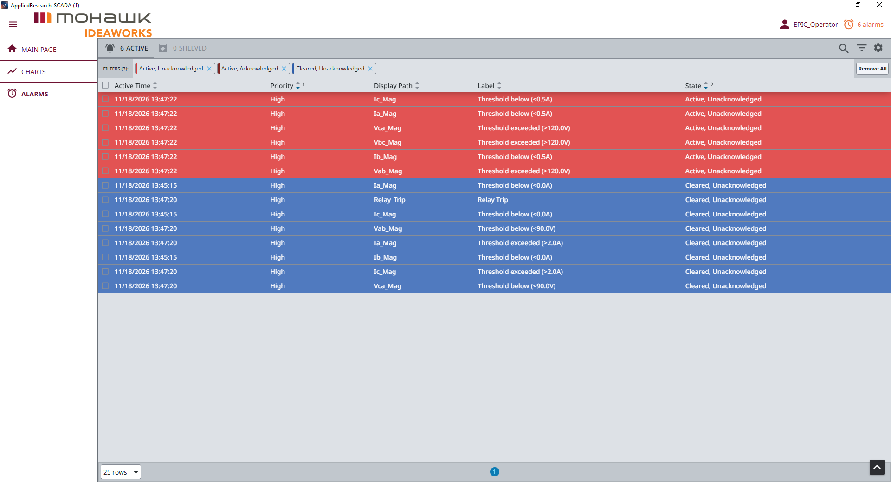
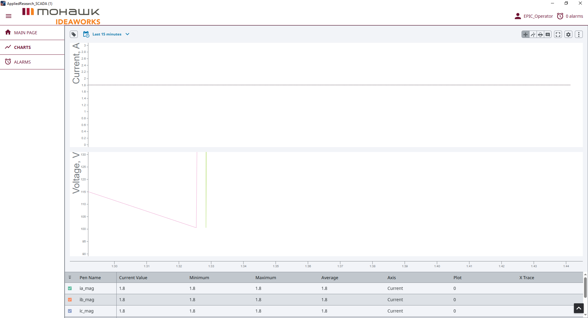

# Applied Research – SCADA for Power Systems

An Ignition 8.3 Perspective SCADA/HMI for an **SEL Protections Relay**, connected over **DNP3**. The project monitors a simulated feeder in real time, controls its circuit breaker with a select-before-operate workflow, raises threshold alarms, trends voltage and current from the historian, and records every significant event in a SQL Server sequence-of-events (SOE) table.

It was built at the Energy & Power Innovation Centre (EPIC), Mohawk College, as the reference implementation for the Applied Research course *SCADA for Power Systems*.



## Contents

- [Features](#features)
- [System architecture](#system-architecture)
- [DNP3 point map and tags](#dnp3-point-map-and-tags)
- [HMI walkthrough](#hmi-walkthrough)
  - [Main page — normal operation](#main-page--normal-operation)
  - [Circuit breaker control](#circuit-breaker-control)
  - [Fault and trip sequence](#fault-and-trip-sequence)
  - [Alarms](#alarms)
  - [Trending](#trending)
- [Sequence of events (SOE) log](#sequence-of-events-soe-log)
- [Security](#security)
- [Gate 2 requirement coverage](#gate-2-requirement-coverage)
- [Repository structure](#repository-structure)
- [Setup](#setup)

## Features

- **Live single-line diagram (SLD)** with phase currents, line voltages, P/Q/S, power factor and frequency. Breaker, feeder and relay colours follow the state of the simulated circuit.
- **Select-before-operate breaker control** from a popup (ARM → OPEN/CLOSE, with CANCEL), sent to the relay as DNP3 direct-operate pulses through `system.dnp`.
- **Trip indication and Target Reset** directly on the SLD.
- **Threshold alarms** on every voltage and current point and on the relay trip, with setpoints held in memory tags so they can be changed at runtime without editing the alarm.
- **Historical trending** of voltage and current on one Power Chart with separate, labelled axes that survive page navigation.
- **SOE log** in a dedicated SQL Server table, written with parameterised queries and shown below the SLD with category icons.
- **Role-based security**: sign-in is required, and only Operator or Administrator users can open the breaker control popup.

## System architecture



| Layer | Component | Role |
|---|---|---|
| Simulation | OMICRON RelaySimTest + CMC test set | Models the source, breaker, feeder and load, and injects secondary voltages and currents (including faults) into the relay |
| Protection | SEL-751 Feeder Protection Relay | Meters V, I, P, Q, S, PF and frequency, trips on overcurrent, acts as the DNP3 outstation |
| Relay configuration | SEL QuickSet | Relay settings and DNP3 map |
| SCADA server | Ignition Gateway 8.3 with the DNP3 driver | DNP3 master; device name `SEL-751` |
| Tags | Realtime provider `OPC-UA-to-MySQL` | Folder `_SEL-751_` with OPC tags, threshold memory tags and alarms |
| Database | Microsoft SQL Server Express, connection `MicrosoftSQL` | Tag history provider `AppliedResearch` and the SOE table `soe_AR` |
| HMI | Ignition Perspective | Runs in a browser or in Perspective Workstation |

## DNP3 point map and tags

All points live under `[OPC-UA-to-MySQL]_SEL-751_/Points`, with OPC item paths of the form `ns=1;s=[SEL-751]<PointType><Index>`. The `_Diagnostics_` folder exposes the driver's `Status`, `Name`, `Port`, `IIN`, `Connected` and `Hostname`.

| DNP3 point | Tag | Unit | Notes |
|---|---|---|---|
| AI 0 | `Ia_Mag` | A | |
| AI 1 | `Ib_Mag` | A | |
| AI 2 | `Ic_Mag` | A | |
| AI 3 | `Vab_Mag` | V | |
| AI 4 | `Vbc_Mag` | V | |
| AI 5 | `Vca_Mag` | V | |
| AI 6 | `Frequency_Mag` | Hz | |
| AI 7 | `RealPower_Mag` | W | |
| AI 8 | `ReactivePower_Mag` | VAR | |
| AI 9 | `ApparentPower_Mag` | VA | |
| AI 10 | `PF_Mag` | % | |
| BI 0 | `Relay_Trip` | — | Overcurrent protection trip; alarmed |
| BI 1 | `CB_Status` | — | `True` = breaker closed |
| BI 2 | `CB_Open_Feedback` | — | Relay acknowledgement of the OPEN command |
| BI 3 | `CB_Close_Feedback` | — | Relay acknowledgement of the CLOSE command |
| BI 5 | `FrontPanel_LED` | — | Front-panel trip target; stays latched until Target Reset |
| BO 0 | `CB_Open` | — | Open breaker command (pulse) |
| BO 1 | `CB_Close` | — | Close breaker command (pulse) |
| BO 2 | `Target_Reset` | — | Target reset command (pulse) |

Voltage and current tags use linear scaling (raw 0–10 → scaled 0–1) because the relay reports these analogs multiplied by 10.

Alarm setpoints are not typed into the alarms. Each voltage and current point has its own pair of memory tags, and the alarms bind to them:

```
_SEL-751_/
├── _Diagnostics_/                Status, Name, Port, IIN, Connected, Hostname
└── Points/
    ├── Ia_Mag … Vca_Mag          OPC tags with alarms and history
    ├── Frequency_Mag, RealPower_Mag, ReactivePower_Mag, ApparentPower_Mag, PF_Mag
    ├── Relay_Trip, CB_Status, CB_Open_Feedback, CB_Close_Feedback, FrontPanel_LED
    ├── CB_Open, CB_Close, Target_Reset
    └── Alarm Thresholds/
        └── Ia_Mag … Vca_Mag/
            ├── Lower             memory tag (Float4)
            └── Upper             memory tag (Float4)
```

## HMI walkthrough

Every page shares two docked views:

- **Header** (top, 60 px): the Mohawk IDEAWORKS logo, the signed-in user (click to sign in or out) and a live count of active, unacknowledged `_SEL-751_` alarms. The count refreshes every 2 seconds, the icon is highlighted whenever the count is above zero, and clicking it opens the Alarms page.
- **Menu** (left, 210 px): Main Page (`/`), Charts (`/charts`) and Alarms (`/alarms`). The current page is shown in bold.

### Main page — normal operation

The screenshot at the top of this README shows the Main page during normal operation. The SLD shows the source, the breaker, the feeder and the load, with the voltage transformer on the source side and the current transformer on the load side, both wired to the SEL-751. Measurement boxes show `Ia/Ib/Ic`, `Vab/Vbc/Vca`, `P/Q/S`, power factor and frequency through expression bindings that append the units.

In this screenshot the breaker is closed, each phase carries about 1.8–1.9 A at roughly 100.5 V line-to-line, the load draws 326.5 W at 98.7 % power factor, and the header shows no active alarms.

| SLD element | Driven by | Behaviour |
|---|---|---|
| Breaker symbol | `CB_Status` | Green when closed, red when open |
| Feeder line and load arrow | Breaker state | Green when energised, red after the breaker opens |
| SEL-751 outline and text | `FrontPanel_LED` | Blue normally, red while the trip target is latched |
| `TRIPPED!` label | `Relay_Trip` | Shown only while the trip is asserted |
| Target Reset button | `FrontPanel_LED` | Shown only while the trip target is latched; pulses BO 2 |
| Breaker symbol (click) | User role | Opens the Circuit Breaker popup for Operator and Administrator users |

The SOE table below the SLD lists the newest events first (see [Sequence of events (SOE) log](#sequence-of-events-soe-log)).

### Circuit breaker control



Clicking the breaker opens the **Circuit Breaker** popup. It shows the breaker ID (`CB-1`) and its live state (`Open`/`Closed` from `CB_Status`), and implements a select-before-operate workflow:

1. **ARM** logs `LatchON Sent (ARM)` with the signed-in user as actor, waits 2 seconds, sets the view's `armed` custom property and logs `LatchON Received (ARM)`. ARM and CANCEL are internal to the HMI and send nothing to the relay.
2. While armed, **OPEN**, **CLOSE** and **CANCEL** become active. When disarmed they are greyed out, as in the screenshot.
3. **CANCEL** logs `LatchOFF Sent/Received (ARM)` and disarms.
4. **OPEN** or **CLOSE** logs `Pulse Sent (OPEN/CLOSE)`, waits 0.4 seconds, sends a DNP3 direct-operate pulse and disarms.
5. The relay's feedback inputs log `Pulse Received (OPEN/CLOSE)`, and the change of `CB_Status` logs `Circuit Breaker Status Transition`.

The popup always opens and closes disarmed. All DNP3 commands go through one small gateway script module:

```python
# ignition/script-python/dnpControl/code.py
DEVICE = "SEL-751"
PULSE_ON = 1
TCC = 0
COUNT = 1
PULSE_MS = 2000

def pulse(dnp, index):
    # index 0 = Open, 1 = Close, 2 = Target Reset
    return dnp.directOperateBinary(DEVICE, index, TCC, PULSE_ON, COUNT, PULSE_MS, PULSE_MS)
```

An OPEN followed by a CLOSE, as recorded in the SOE table:

| Time | Point | Value | Description | Actor |
|---|---|---|---|---|
| 13:52:24 | CB_ARM | False | LatchON Sent (ARM) | EPIC_Operator |
| 13:52:26 | CB_ARM | True | LatchON Received (ARM) | System |
| 13:52:26 | CB_Open | False | Pulse Sent (OPEN) | EPIC_Operator |
| 13:52:27 | CB_Open | True | Pulse Received (OPEN) | System |
| 13:52:29 | Vca_Mag / Ia_Mag | 120.2 V / 0.0 A | Threshold exceeded (>120.0 V) / Threshold below (<0.5 A) | |
| 13:52:30 | CB_Status | False | Circuit Breaker Status Transition | System |
| 13:52:33 | CB_ARM | False | LatchON Sent (ARM) | EPIC_Operator |
| 13:52:35 | CB_ARM | True | LatchON Received (ARM) | System |
| 13:52:36 | CB_Close | False | Pulse Sent (CLOSE) | EPIC_Operator |
| 13:52:37 | CB_Close | True | Pulse Received (CLOSE) | System |
| 13:52:39 | Vca_Mag / Ia_Mag | 100.5 V / 1.9 A | Threshold Alarm Cleared | |
| 13:52:40 | CB_Status | True | Circuit Breaker Status Transition | System |

### Fault and trip sequence

A fault involving phase A was applied from RelaySimTest at 13:53:42.

**Immediately after the fault.** Phase A current jumps to 4.3 A and `Vab` and `Vca` sag to about 70–73 V. `Relay_Trip` asserts, so the `TRIPPED!` label appears, the relay outline turns red and the Target Reset button appears. The breaker is still drawn closed because `CB_Status` has not changed yet, and the header still reads 0 alarms until its next 2-second refresh.



**After the breaker opens.** The breaker and the feeder downstream of it turn red, all currents and P/Q/S drop to zero, and the voltages on the source side rise to about 120.1 V. `Relay_Trip` has already reset, so the `TRIPPED!` label is gone, but the front-panel target stays latched: the relay remains red and Target Reset stays visible until the operator clicks it. Six alarms are now active: the three currents below 0.5 A and the three voltages above 120 V.



Key SOE entries for this event:

| Time | Point | Value | Description |
|---|---|---|---|
| 13:53:42 | Relay_Trip | True | SEL-751 Relay Tripped! |
| 13:53:42 | Ia_Mag | 2.9 A | Threshold exceeded (>2.0 A) |
| 13:53:42 | Vca_Mag | 85.5 V | Threshold below (<90.0 V) |
| 13:53:44 | Relay_Trip | False | Threshold Alarm Cleared |
| 13:53:44 | Vca_Mag | 94.2 V | Threshold Alarm Cleared |
| 13:53:45 | Ia_Mag | 0.0 A | Threshold Alarm Cleared |
| 13:53:45 | Ia_Mag | 0.0 A | Threshold below (<0.5 A) |
| 13:53:45 | CB_Status | False | Circuit Breaker Status Transition |
| 13:53:45 | Vca_Mag | 120.2 V | Threshold exceeded (>120.0 V) |

To restore the feeder, clear the fault in RelaySimTest, click **Target Reset**, then ARM and CLOSE the breaker from the popup.

### Alarms



The Alarms page is a Perspective Alarm Status Table filtered to `prov:OPC-UA-to-MySQL:/tag:_SEL-751_/*`. It shows only Active Time, Priority, Display Path, Label and State. The display path is bound to the tag name, and each label is an expression that shows the threshold currently in force. Red rows are active and unacknowledged; blue rows have cleared but still need acknowledging.

| Tags | Alarm | Mode | Setpoint | Priority |
|---|---|---|---|---|
| `Ia/Ib/Ic_Mag`, `Vab/Vbc/Vca_Mag` | Alarm Lower | Below value | `[.]Alarm Thresholds/<tag>/Lower` | High |
| `Ia/Ib/Ic_Mag`, `Vab/Vbc/Vca_Mag` | Alarm Upper | Above value | `[.]Alarm Thresholds/<tag>/Upper` | High |
| `Relay_Trip` | Alarm Upper | Equal to setpoint | `1.0` (trip asserted) | High |
| All of the above | Alarm BadQuality | Bad quality | — | Diagnostic |

The thresholds used in these screenshots are 90.0 V to 120.0 V for voltages and 0.5 A to 2.0 A for currents. Because the setpoints are tag bindings, writing a new value to an `Upper` or `Lower` memory tag moves the alarm limit straight away, with no change to the alarm configuration. Every alarm's active, cleared and acknowledged events are also written to the SOE table.

### Trending



The Charts page is a single Power Chart showing the six historized voltage and current tags from the `AppliedResearch` history provider. Current and voltage sit on separate plots with their own labelled axes: **Current, A** (0–3 A) and **Voltage, V** (90–130 V).

The chart's `axes`, `pens` and `plots` properties are bound bidirectionally to `session.custom.trending`. Pens and axes the operator sets up therefore stay in place when they leave the Charts page and come back later in the same session.

## Sequence of events (SOE) log

Events are written to a dedicated table rather than Ignition's audit log or alarm journal. All inserts go through one function in the `_soe` script module:

```python
# ignition/script-python/_soe/code.py
def log(description, pointName=None, pointValue=None, actor=None, category=None):
    system.db.runPrepUpdate(
        "INSERT INTO soe_AR (event_category, point_name, point_value, description, actor) VALUES (?, ?, ?, ?, ?)",
        [category, pointName, pointValue, description, actor]
    )
```

The module also provides `alarmClass()` (maps alarm names to `Threshold` or `BadQuality`), `qualityText()` (readable quality text for bad-quality events) and `getUser(session)` (the signed-in user name, used as the actor).

| Source | Logged description | Category | Actor |
|---|---|---|---|
| Session startup / shutdown | Perspective Session Login / Logout | `info` | Signed-in user |
| Popup ARM / CANCEL | LatchON / LatchOFF Sent and Received (ARM) | `control` | User, then System |
| Popup OPEN / CLOSE | Pulse Sent (OPEN / CLOSE) | `control` | Signed-in user |
| `CB_Open_Feedback`, `CB_Close_Feedback` (rising edge) | Pulse Received (OPEN / CLOSE) | `control` | System |
| `CB_Status` value change | Circuit Breaker Status Transition | `control` | System |
| Voltage and current alarms | Alarm label, Threshold Alarm Cleared, Threshold Alarm Acknowledged | `alarm_active`, `alarm_clear`, `control` | Acknowledging user |
| `Relay_Trip` alarm | SEL-751 Relay Tripped!, Threshold Alarm Cleared | `alarm_active`, `alarm_clear` | — |

The Main page table is fed by the named query `soe_event`, polled every 0.5 seconds:

```sql
SELECT event_category, point_name, point_value, description, actor,
       FORMAT(event_timestamp, 'yyyy-MM-dd HH:mm:ss') AS event_timestamp
FROM soe_AR
ORDER BY event_timestamp DESC
```

A script transform on the binding adds the icon column from `event_category`:

| Category | Icon | Colour |
|---|---|---|
| `info` | Information | Blue |
| `alarm_active` | Alarm bell | Red |
| `alarm_clear` | Check mark | Green |
| `control` | Warning triangle | Amber |

The repository does not contain the table definition. The scripts only need the five inserted columns plus an `event_timestamp` column that defaults to the insert time. An example for SQL Server:

```sql
CREATE TABLE soe_AR (
    id              INT IDENTITY(1,1) PRIMARY KEY,
    event_category  VARCHAR(32)  NULL,
    point_name      VARCHAR(64)  NULL,
    point_value     VARCHAR(64)  NULL,
    description     VARCHAR(255) NOT NULL,
    actor           VARCHAR(64)  NULL,
    event_timestamp DATETIME2(3) NOT NULL DEFAULT SYSDATETIME()
);
```

## Security

The project's session permissions require an authenticated user, and the header provides sign-in and sign-out. The breaker symbol on the SLD is enabled only when

```
isAuthorized(false, "Authenticated/Roles/Operator", "Authenticated/Roles/Administrator")
```

is true. An **Operator** (or Administrator) can monitor and control the breaker. Any other signed-in user, such as a read-only **Monitor** account, can view every page and acknowledge alarms but cannot open the breaker control popup. User names are written to the SOE table as the actor for logins, logouts, control commands and alarm acknowledgements.

## Gate 2 requirement coverage

| Requirement | Where it is implemented |
|---|---|
| Responsive SLD showing every voltage, current and power tag | `Page/Home` SVG with expression bindings |
| Docked navigation to Main, Alarms and Trending | Shared docks `Header/Header` (top) and `Docks/Menu` (left) |
| One Power Chart with labelled voltage and current axes that keeps its data across navigation | `Page/Charts`, bound to `session.custom.trending` |
| Alarms on every voltage, current and trip tag, with threshold memory tags | `_SEL-751_/Points/Alarm Thresholds`, `Page/Alarms` |
| CB popup with Arm, Cancel and Open/Close; `system.dnp` for Open/Close and Target Reset | `Popup Pages/Circuit Breaker`, `dnpControl` |
| Event log in a dedicated table via `system.db.runPrepUpdate`, shown below the SLD | `_soe`, named query `soe_event`, `soe_AR` |
| Operator and Monitor accounts; Monitor cannot open the CB popup | `isAuthorized()` binding on the breaker symbol |

## Repository structure

```
.
├── project.json
├── ignition/
│   ├── script-python/
│   │   ├── _soe/code.py                      # SOE logging helpers
│   │   └── dnpControl/code.py                # DNP3 direct-operate wrapper
│   └── named-query/
│       └── soe_event/query.sql               # Query behind the SOE table
├── com.inductiveautomation.perspective/
│   ├── page-config/config.json               # Pages and shared docks
│   ├── session-props/props.json              # session.custom.trending
│   ├── session-permissions/                  # Requires Authenticated
│   ├── startup/onStartup.py                  # Logs session login
│   ├── shutdown/onShutdown.py                # Logs session logout
│   ├── style-classes/
│   └── views/
│       ├── Header/Header
│       ├── Docks/Menu
│       ├── Page/Home                         # SLD + SOE table
│       ├── Page/Alarms
│       ├── Page/Charts
│       ├── Page/Event Icon/EventIcon         # Icon cell for the SOE table
│       └── Popup Pages/Circuit Breaker
└── docs/images/                              # Screenshots used in this README
```

## Author

Andrei Veremeenko — SCADA Systems Analyst (Applied Research), Energy & Power Innovation Centre (EPIC), Mohawk College.
